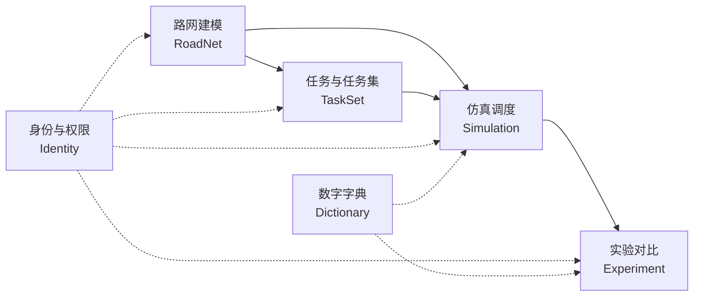
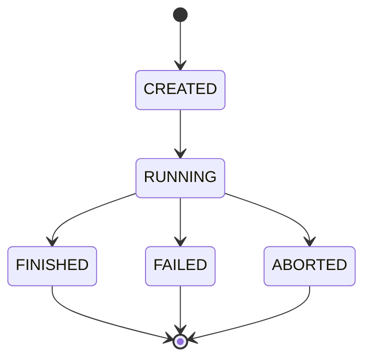
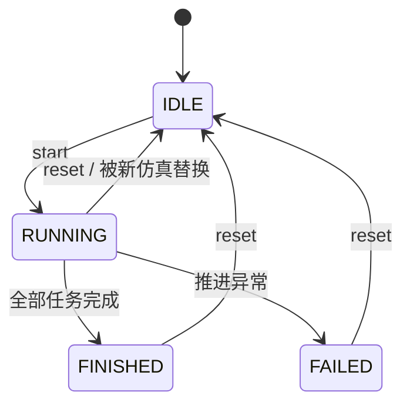
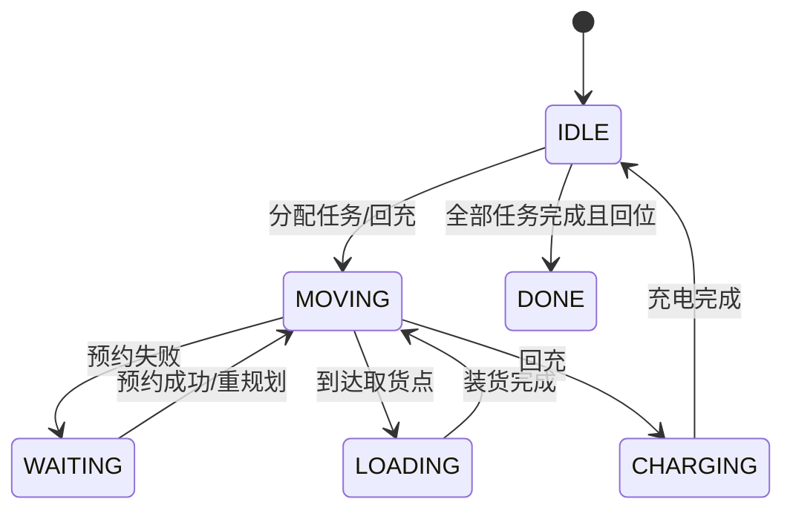

# 领域模型与术语

> 本文是本项目的**领域术语唯一真源**。代码、接口、页面文案、论文和答辩稿出现不一致时，以本文为准。
> 本文只回答「是什么、对应哪段代码、有什么约束」，不写操作步骤。操作步骤见 `docs/how-to/`，建模取舍见 `docs/explanation/领域模型说明.md`。

## 1. 使用方式

- 新增或修改实体、字段、接口、页面文案中的领域名词前，先改本文。
- 新术语必须先在本表登记「中文名 / 代码名 / 定义 / 约束」，再写代码。
- 同一概念只保留一个规范名；历史名称统一收进「已知别名」，不静默改名。
- 本文与代码冲突时，先确认哪边是预期行为；修正后同步另一方，并记录到提交说明。

## 2. 限界上下文

| 上下文 | 职责 | 核心对象 | 主要代码 |
|---|---|---|---|
| 路网建模 | 维护车间拓扑、节点类型、路段属性和合法性 | `RoadNet`、`NetNode`、`NetEdge`、`Arc` | `agv-algorithm/model`、`RoadNetService`、`RoadNetEditor.vue` |
| 任务与任务集 | 维护搬运任务，绑定路网并保证端点合法 | `TaskSet`、`Task` | `TaskSetService`、`TaskSetValidator`、`TaskSetView.vue` |
| 仿真调度 | 按 tick 推进 AGV、分配任务、预约资源、输出帧 | `SimulationEngine`、`TaskAssigner`、`ReservationTable`、`SimFrame` | `agv-algorithm/sim`、`SimulationService` |
| 实验对比 | 用同一路网和任务集换算法重跑，保存指标与历史 | `Experiment`、`ExperimentMetric` | `ExperimentService`、`ExperimentView.vue` |
| 身份与权限 | 登录、JWT、角色控制 | `SysUser` | `AuthService`、`SecurityConfig` |
| 数字字典 | 提供算法、指标等枚举显示名 | `SysDict` | `DictService` |

依赖方向：任务集依赖路网，仿真依赖路网和任务集，实验依赖仿真结果。路网建模不反向依赖任何上层上下文。

## 3. 聚合与一致性边界

| 聚合根 | 组成 | 一致性规则 | 存储与事务 |
|---|---|---|---|
| `RoadNet` | `NetNode`、`NetEdge`（值对象） | 编号唯一、端点存在、无自环、无重复建边、至少一个充电位、无死胡同、缓存位为叶子、充电位可达全部工位、数值合法 | 整张图存为 `roadnet.roadnet_json`，一次保存一个事务 |
| `TaskSet` | 任务列表、绑定路网 `roadnetId` | 至少一条任务；端点属于绑定路网、必须是工位、起终点不同且可达；任务编号去重并按升序排列 | 任务列表存为 `task_set.tasks_json`，保存前整体校验 |
| `Experiment` | 实验头 + 输入快照 + `ExperimentMetric` | 路网与任务集必须匹配；任务集必须绑定该路网；状态只能单向流转；快照写入后不可变 | `experiment` 与 `experiment_metric` 分表，一次实验一个逻辑聚合 |

`Simulation` 不是持久化聚合，而是由 `SimulationService` 编排的应用服务：引擎和预约表只存在于内存，运行结束后才落成 `Experiment`。

## 4. 核心术语

### 4.1 路网建模

| 术语 | 代码 / 接口 | 定义 | 约束 |
|---|---|---|---|
| 路网 | `RoadNet` | 由节点、物理路段和拆好的有向弧组成的拓扑图，是路径规划和仿真的唯一真源 | 构造时不做合法性校验；保存前必须过 `RoadNetValidator` |
| 车间地图 | 页面「车间地图」 | 路网编辑页的用户可见名称，不是独立领域对象 | 等价于路网编辑工作台 |
| 路网记录 | `RoadNetEntity` | 路网的持久化实体，一条记录保存一张整图 | 表名 `roadnet`；只负责存储，不是领域模型 |
| 路网载荷 | `RoadNetPayload` | 前后端传输的 JSON：`nodes`、`edges`、`width`、`height` | 旧数据缺少 `width`/`height` 时按 50×34 处理 |
| 节点 | `NetNode` | 路网中的一个可停靠点 | `id` 单图唯一；`x`/`y` 单位米；`capacity ≥ 1` |
| 工位 | `NodeType.WORKSTATION` | 任务的起点和终点，装卸货发生地 | 任务端点只能是工位 |
| 充电位 | `NodeType.CHARGER` | AGV 的初始停放位和空闲回位点 | 有效路网至少一个；AGV 按轮转分配到充电位 |
| 缓存位 | `NodeType.BUFFER` | 等待避障时的安全停靠点 | 必须位于支路末端，只连接一条路段 |
| 路口 | `NodeType.JUNCTION` | 路网交叉点，按临界区处理 | 默认容量 1；节点容量可配置，但大于 1 会削弱一车一区的语义 |
| 节点容量 | `NetNode.capacity` | 同一时刻允许停靠在该节点的 AGV 数 | 默认 1，必须 ≥ 1；充电位可配大用于排队 |
| 路段 | `NetEdge` | 两个节点之间的物理通道，方向、速度、容量、车道都在这里定义 | `length > 0`、`speed > 0`、`capacity ≥ 1`；长度由两端坐标派生 |
| 有向弧 | `Arc` | 算法层最小通行单位，编号形如 `E1+` / `E1-` | 双向路段拆两条，单向只保留一条；A*、预约、仿真只认弧 |
| 方向 | `EdgeDirection` | `ONE_WAY` 单向 / `TWO_WAY` 双向 | 单向只生成一条弧；双向生成正反两条弧 |
| 车道 | `LaneMode` | `SINGLE` 单车道 / `DUAL` 双车道 | 双车道只对双向路段生效；单向一律按单车道 |
| 路段容量 | `NetEdge.capacity` | 双车道时**每个方向**可同时容纳的 AGV 数 | 单车道始终按 1 处理 |
| 路段速度 | `NetEdge.speed` | 米/秒 | 必须 > 0；不同路段可以不同 |
| 画布尺寸 | `RoadNetPayload.width/height` | 编辑器可放置节点的范围，单位米 | 10–200 米，默认 50×34；不参与算法计算 |
| 模板 | `RoadNetEntity.isTemplate` | 系统预置、不可直接覆盖的路网 | 调度人员修改后只能另存为副本 |
| 副本 | 另存为生成的新记录 | 从当前路网复制出的自建路网 | 拥有新的 `id`，与原图解耦 |
| 校验错误 | `ValidationError` | `code`、`message`、`nodeId`、`edgeId` 四元组 | 前端据此标红和定位 |
| 校验结果 | `ValidationResult` | `valid` + 错误列表 | 前端软提示、后端硬拦截共用 |

### 4.2 任务与任务集

| 术语 | 代码 / 接口 | 定义 | 约束 |
|---|---|---|---|
| 任务 | `Task` / `TaskDto` | 一次搬运：从 `from` 取货送到 `to` | `from`、`to` 必须是同一路网的工位；两者不能相同 |
| 任务编号 | `Task.id` | 任务在任务集内的序号 | 保存时去重并按升序排列；编号为空或重复的任务分配「当前最大号 + 1」 |
| 任务集 | `TaskSet` | 一组绑定到某张路网的搬运任务 | 至少一条任务；不能跨图复用节点编号 |
| 绑定路网 | `TaskSet.roadnetId` | 任务集所属的路网 ID | 删除被引用的路网会被拒绝；数据库列 `roadnet_id` |
| 任务集载荷 | `TaskSetPayload` | `{ tasks: TaskDto[] }` | 保存时排序并补齐编号 |
| 任务集校验 | `TaskSetValidator` | 校验端点存在、类型、起终点不同、可达 | 错误信息带任务序号和节点编号 |

### 4.3 仿真与调度

| 术语 | 代码 / 接口 | 定义 | 约束 |
|---|---|---|---|
| AGV | `AgvSnapshot` | 仿真中的一台小车，编号形如 `AGV-1` | 数量由 `agvCount` 决定；初始化时轮转停到充电位 |
| AGV 状态 | `AgvStatus` | `IDLE` 空闲、`MOVING` 行驶、`WAITING` 冲突等待、`LOADING` 装卸、`CHARGING` 回充、`DONE` 完成 | 前端按状态着色 |
| 仿真 | `SimulationEngine` | 按 tick 推进的离散事件式路网仿真 | 引擎不依赖 Spring，可单测 |
| tick | `SimConfig.TICK_MILLIS` | 仿真时间步，默认 100ms | 指标里的时间都是 tick 数，展示时再换算 |
| 仿真参数 | `SimConfig` | `agvCount`、`seed`、`algorithm`、`serviceTicks`、`waitTimeoutTicks`、`maxTicks` | 默认装卸 5 tick、等待 30 tick 触发重规划、最大 200000 tick |
| 装卸时间 | `serviceTicks` | 每次装货或卸货占用的 tick 数 | 默认 5 tick = 0.5 秒 |
| 速度倍率 | `SimulationService.speed` | 实时播放倍速，范围 0.25–8.0 | 只改变推送间隔，不改变仿真结果 |
| 调度策略 | `TaskAssigner` | 决定空闲 AGV 接哪条任务的策略接口 | 字典码 `nearest` / `greedy-eta` |
| 就近分配 | `NearestAssigner` | 选欧氏距离最近的取货点 | 不预判路网绕行，可能「看起来近、实际远」 |
| 贪心 ETA | `GreedyEtaAssigner` | 用 A* 估算空驶 + 送达总时间，选预计完成最早的任务 | 考虑绕行和单行道，单次寻路开销更大 |
| 路径规划 | `AStarPlanner`、`PathResult` | 在 `Arc` 上搜索从起点到终点的有向路径 | 结果含弧序列、总代价、总里程、扩展状态数 |
| 逐段滚动预约 | `ReservationTable` | 记录节点/弧在时间区间内被哪些 AGV 占用 | AGV 进入一条弧才登记，不出发前预约全程 |
| 预约区间 | `Interval` | 半开区间 `[start, end)` | 资源容量内允许并存 |
| 冲突等待 | `AgvStatus.WAITING` | 预约失败或下一段被占导致的停车 | 一次连续等待只记一次冲突 |
| 重规划 | `SimEvent.Type.REPLAN` | 连续等待超过阈值后带禁行约束重新寻路 | 默认 `waitTimeoutTicks = 30` |
| 死锁打破 | `SimEvent.Type.DEADLOCK_BREAK` | 检测到等待环后强制打破 | 只推事件，不落库 |
| 帧 | `SimFrame` | 一次 tick 推送的完整画面：`tick`、`agvs`、`events`、`finished`、`metrics` | WebSocket 通道 `/ws/sim` |
| 事件 | `SimEvent` | 任务分配、装货、完成、冲突、重规划等瞬时事件 | 只推前端日志面板，不落库 |
| 实时指标 | `SimFrame.Metrics` | 当前帧的 `makespan`、总路径长、总等待、冲突数、完成/总任务数 | 与实验指标同口径 |
| 仿真会话 | `SimulationRunner` | 一个用户的一份仿真运行态：引擎、调度线程、暂停/倍速、实验 ID | 按用户隔离；同一用户同时最多一个 |
| 仿真运行状态 | `SimulationRunner.status` | `IDLE`、`RUNNING`、`FINISHED`、`FAILED` | 每个用户独立；暂停/恢复不改变状态；重置回 `IDLE` |

### 4.4 实验与指标

| 术语 | 代码 / 接口 | 定义 | 约束 |
|---|---|---|---|
| 实验 | `Experiment` | 一次可复现的仿真运行记录：路网 + 任务集 + 算法 + AGV 数 + 随机种子 | `algorithm` 取字典码；`seed` 保证同参数结果一致；同时保存输入快照 |
| 实验输入快照 | `Experiment.roadnetSnapshot` / `tasksetSnapshot` | 创建实验时整张路网与任务集 JSON 的原文，写入后不可修改 | 用于回放；旧实验可为空 |
| 回放 | `POST /api/experiment/{id}/replay` | 用实验快照重跑一次并比较四项指标 | 只回放输入，不重放逐帧画面 |
| 对比实验 | `ExperimentService.run` | 同一路网、同一任务集、同一 seed，换算法各跑一次 | `algorithm` 为空时对全部算法各跑一次 |
| 实验状态 | `Experiment.status` | `CREATED`、`RUNNING`、`FINISHED`、`FAILED`、`ABORTED` | 终态不可回退 |
| 实验指标 | `ExperimentMetric` | 实验结束后落库的四项汇总 | 与 `experiment` 一对一 |
| 完成时间 | `makespan` | 最后一件任务完成 tick − 仿真开始 tick | 单位 tick，1 tick = 100ms |
| 总路径长 | `totalPathLen` | 全部 AGV 实走弧长之和，含空驶 | 单位米，保留一位小数 |
| 总等待 | `totalWaitTick` | 处于 `WAITING` 的（车 × tick）之和 | 不含无任务 `IDLE` |
| 冲突次数 | `conflictCount` | 预约失败导致停车的事件次数 | 一次连续等待记 1 次 |
| 实验报表 | `ExperimentReport` | 实验头 + 指标 + 算法显示名的查询视图 | 历史列表按用户和 ID 倒序 |

### 4.5 身份与字典

| 术语 | 代码 / 接口 | 定义 | 约束 |
|---|---|---|---|
| 管理员 | `role = admin` | 可修改任何路网和任务集，可管理用户与字典 | 预置账号 `admin` |
| 调度人员 | `role = dispatcher` | 可使用业务菜单，修改模板后只能另存为副本 | 预置账号 `dispatcher` |
| JWT | `JwtService` | 无状态登录凭证 | 默认 12 小时过期 |
| 数字字典 | `SysDict` | 按 `dictType` 分组的枚举显示名 | 当前有 `algorithm`、`metric` 两组 |
| 审计日志 | `AuditLog` | 有业务含义的写操作记录：谁、何时、对什么、结果如何 | 表名 `sys_audit_log`；写入失败不影响业务 |

### 4.6 主键与标识

| 术语 | 代码 / 接口 | 定义 | 约束 |
|---|---|---|---|
| 主键 ID | `BaseEntity.id` | 所有持久化表统一的 `BIGINT` 主键 | 由应用侧雪花算法生成，数据库不使用自增 |
| 雪花 ID | `SnowflakeIdGenerator` | 53 位数字 ID：41 位毫秒 + 2 位 worker + 10 位序列 | 不超过 JS 安全整数；多实例用 `AGV_WORKER_ID` 区分 |
| 预置 ID | `DataInitializer` | 标准车间 `id=1`、直线车间 `id=2`、演示任务集 `id=1` | 仅用于演示与论文复现，业务数据仍使用雪花 ID |

## 5. 易混淆术语对照

| 说法 A | 说法 B | 关系与建议 |
|---|---|---|
| 车间地图 | 路网 / `RoadNet` | 页面叫「车间地图」，领域对象叫「路网」；不要把页面名当实体名 |
| `RoadNetEntity` | `RoadNet` | 前者是持久化实体，后者是算法层领域模型；当前是两套名字指向同一概念 |
| 节点 | 工位 | 工位是 `type = WORKSTATION` 的节点，节点是上位词 |
| 路段 / `NetEdge` | 有向弧 / `Arc` | 路段是物理无向通道；弧是算法使用的有向单位，双向路段拆两条 |
| 单向 / 双向 | 单车道 / 双车道 | 前者是 `EdgeDirection`，后者是 `LaneMode`，两个正交维度 |
| 节点容量 | 路段容量 | 前者是同时停靠的 AGV 数；后者是每方向可容纳的 AGV 数 |
| 任务 | 任务集 | 任务是一条搬运；任务集是绑定某张路网的一组任务 |
| tick | 秒 / 倍速 | 指标用 tick，1 tick = 100ms；倍速只影响播放，不影响结果 |
| 仿真 | 实验 | 仿真是一次运行过程；实验是运行结束后落库的记录和指标 |
| 事件 | 指标 | 事件是瞬时日志、不落库；指标是四项汇总、随实验落库 |
| 模板 | 副本 | 模板是预置只读基准；副本是另存为后的自建路网 |
| 草稿 | 保存 | 草稿只存在浏览器，用于恢复；保存才写入后端 |

## 6. 领域不变量

### 6.1 路网

- 节点编号、路段编号在单张路网内唯一。
- 路段两端节点必须存在，且不能是同一节点（禁止自环）。
- 同一对节点之间只能有一条物理路段（无向比较）。
- 有效路网至少有一个充电位。
- 不允许「只进不出」的死胡同。
- 缓存位必须只连接一条路段。
- 任一充电位必须能到达全部工位。
- 坐标、长度、速度必须是有限数；长度/速度 > 0；节点/路段容量 ≥ 1。
- 空路网不合法。

对应错误码：

| 错误码 | 含义 |
|---|---|
| `EMPTY` | 路网为空 |
| `DUP_NODE_ID` | 节点编号重复 |
| `DUP_EDGE_ID` | 路段编号重复 |
| `INVALID_NUMBER` | 坐标、长度、速度或容量非法 |
| `ENDPOINT_MISSING` | 路段端点不存在 |
| `SELF_LOOP` | 路段自环 |
| `DUP_EDGE_PAIR` | 同一对节点重复建边 |
| `NO_CHARGER` | 没有充电位 |
| `DEAD_END` | 节点只进不出 |
| `BUFFER_NOT_LEAF` | 缓存位不是叶子 |
| `NOT_CONNECTED` | 充电位无法到达某个工位 |

### 6.2 任务集

- 至少一条任务。
- 必须绑定一张存在的路网。
- 起点和终点必须在该路网中存在。
- 起点和终点必须是工位。
- 起点和终点不能相同。
- 起终点之间必须存在有向路径。
- 任务编号保存时去重并按升序排列；编号为空或重复的任务分配当前最大号 + 1。

### 6.3 实验与运行时

- 任务的 `roadnetId` 必须与实验的 `roadnetId` 一致，且任务集必须绑定该路网。
- 同一用户同一时刻最多一个 `RUNNING` 仿真；不同用户的仿真互不影响。
- 仿真帧只推给发起人的 WebSocket 会话，不广播给其他用户。
- 实验创建后，`roadnet_snapshot` / `taskset_snapshot` 不可修改；回放只读快照，不读当前路网。
- 可回放的实验必须同时具备输入快照和指标记录。
- 成功结束的实验必须有且只有一条指标记录；`FAILED` / `ABORTED` 实验可以没有指标。
- 节点资源容量 = 节点 `capacity`；弧资源容量：双车道取路段 `capacity`，单车道固定 1。
- 同一资源在重叠时间区间内的占用数不能超过容量。
- 路口默认容量 1，按临界区处理。

## 7. 状态机

### 7.1 实验

离线对比实验直接写 `FINISHED` 或 `FAILED`；实时仿真启动时写 `RUNNING`，被新仿真替换、手动重置或后端重启遗留时写 `ABORTED`。`CREATED` 是实体默认值，正常流程可能不会停留。

### 7.2 仿真运行

暂停/恢复只切换 `paused` 标志，不改变 `status`；速度倍率只改变推送间隔。每个用户各有一份独立的状态机，互不共享 `paused`、`speed` 与 `experimentId`。

### 7.3 AGV

## 8. 已知别名与命名差异

| 当前名称 | 含义 | 目标名称 | 处理方式 |
|---|---|---|---|
| `RoadNetEntity` | 路网持久化实体 | 保持 | Phase 1 已完成 |
| `roadnet` | 路网表（原 `warehouse_map`） | 保持 | Phase 3 已完成 |
| `roadnetId` | 任务集/实验绑定的路网 ID（原 `mapId`） | 保持 | Phase 2 已完成 |
| `roadnet_id` | 外键列（原 `map_id`） | 保持 | Phase 3 已完成 |
| 车间地图 | 路网编辑页 | 车间地图 + 页头副标题「路网编辑」 | Phase 4 已完成，保留页面名 |
| `roadnet_json` | 路网整图 JSON 列 | 保留 | 语义清楚，不改 |

改名必须按阶段执行，不允许一次性全改。详细步骤和回滚方式见 [统一领域命名](../how-to/统一领域命名.md)。

## 9. 相关文档

- [如何编辑车间地图](../how-to/编辑车间地图.md)
- [如何维护任务集](../how-to/维护任务集.md)
- [实验快照与回放](实验快照与回放.md)
- [多用户仿真](多用户仿真.md)
- [审计日志](审计日志.md)
- [领域模型说明](../explanation/领域模型说明.md)
- [如何统一领域命名](../how-to/统一领域命名.md)
- [README 的 API 与错误码](../../README.md)
