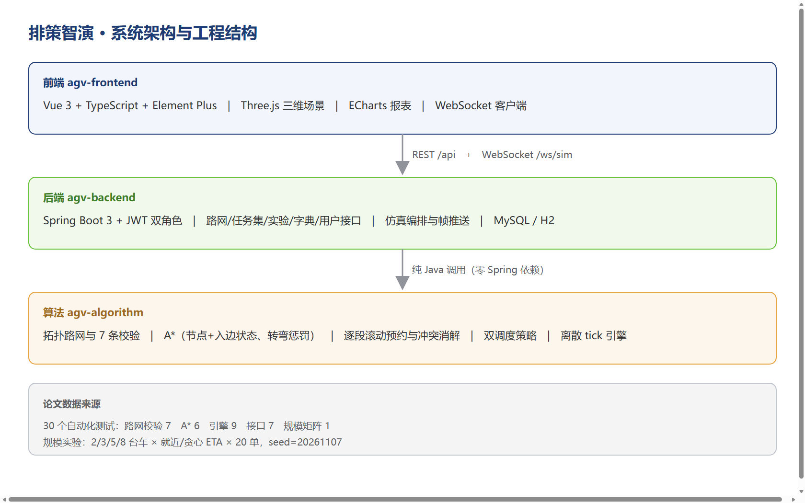
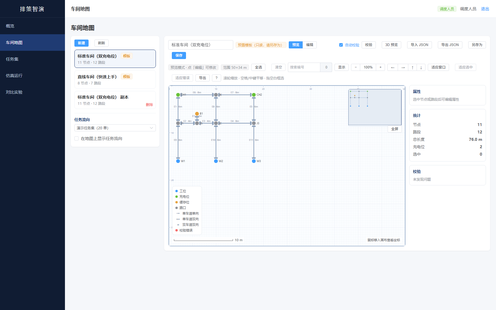
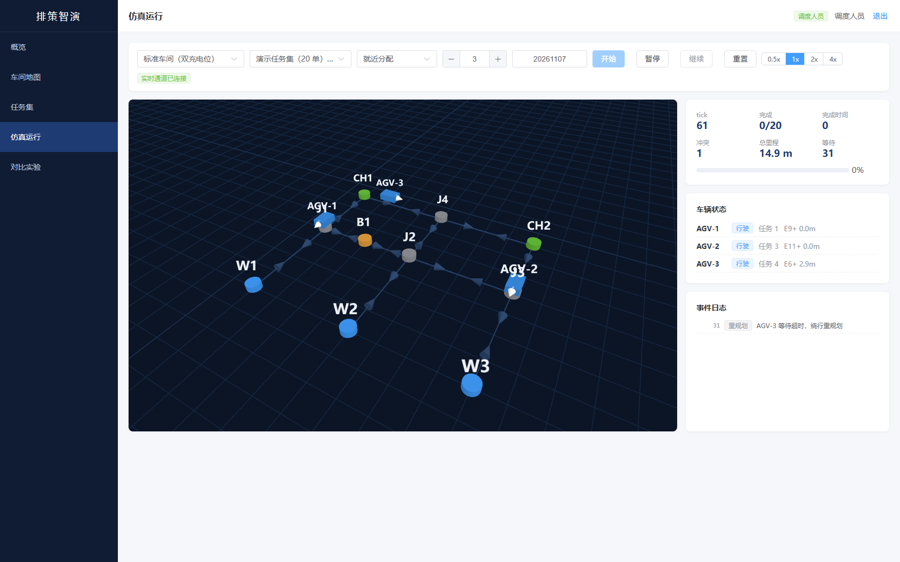
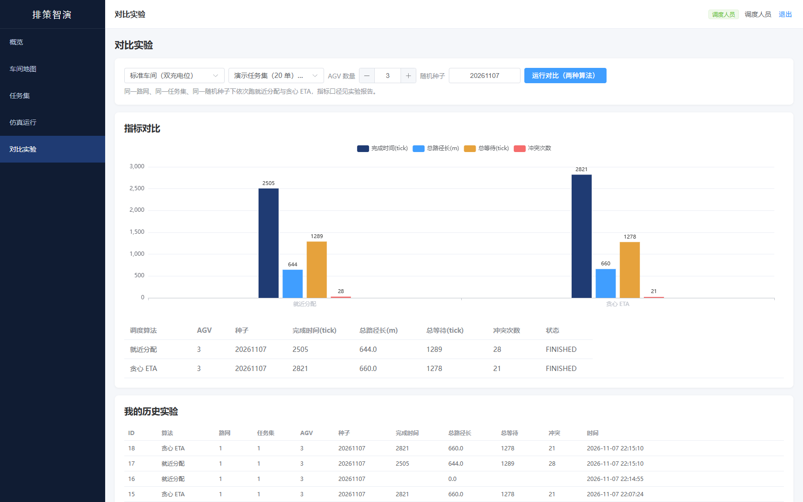
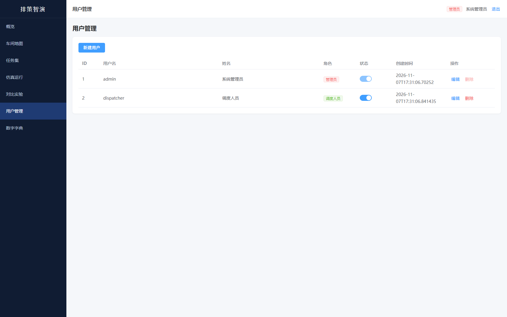
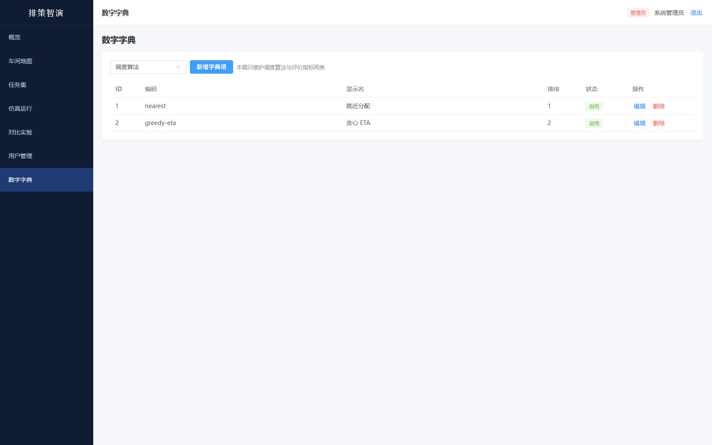
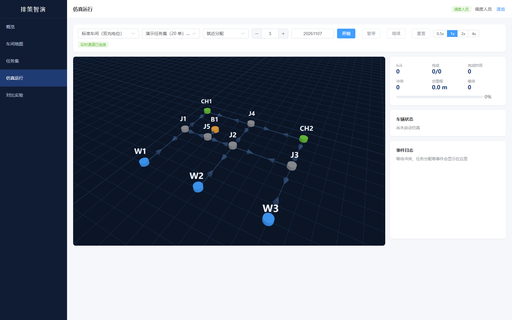
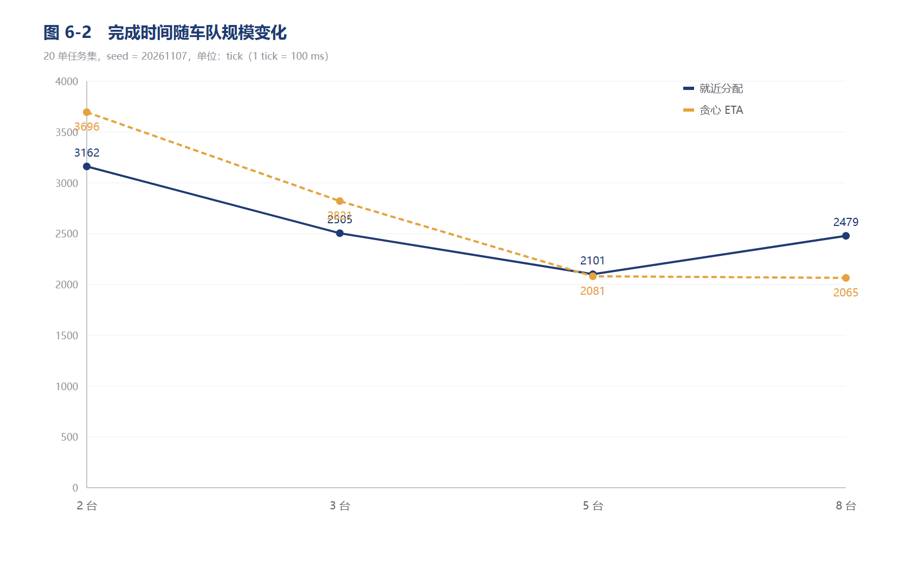
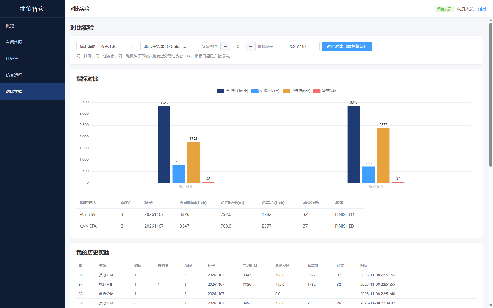

# 排策智演——车间 AGV 小车集群路径规划仿真与调度可视化系统

**本科毕业设计论文**

| 项目 | 内容 |
|---|---|
| 学生姓名 | |
| 学号 | |
| 专业班级 | |
| 指导教师 | |
| 完成日期 | 2027 年 1 月 |

> 本文档由 `paper/thesis/` 下各章合并生成，插图位于 `paper/thesis/figures/`。

# 摘要

## 中文摘要

随着智能制造与仓储物流自动化的发展，AGV 集群已成为车间物料搬运的核心装备。多台 AGV 的调度涉及任务分配、路径规划与冲突消解三个相互耦合的问题，其效果高度依赖路网结构与调度策略。真实环境下的对比实验需要高昂的设备投入，且路径冲突与死锁在真车上表现为碰撞，试错成本不可接受。为此，本文设计并实现了一套面向车间的多 AGV 路径规划仿真与调度可视化系统。

系统仿真的是调度算法的运行环境，调度算法本身是真实运行的代码。系统以拓扑路网描述车间，节点区分工位、充电位、缓存位与路口，路段携带长度、单双向、速度与容量；加载时把双向路段拆分为正反两条有向弧。路径规划采用图上 A\*，把搜索状态扩展为"节点 + 入边"二元组以正确处理转弯惩罚，并以状态空间 Bellman-Ford 作为参考解在随机路网上完成对拍验证。

冲突消解采用逐段滚动预约：车辆只预约下一段弧与目标节点，等待期间释放节点占用。该设计使资源持有者必为行驶中的车辆，从结构上排除了资源等待环；辅以等待超时重规划与等待环检测作为兜底。任务分配实现就近分配与贪心 ETA 两种策略，二者在同一路网、任务集与随机种子下对比。

系统采用 Spring Boot + Vue 3 + Three.js + WebSocket 实现，后端以 100 ms 为周期推送车辆位置与事件，前端插值渲染三维场景，支持暂停、调速与重置。在包含 10 个节点、11 条路段的标准车间与 20 个任务的演示任务集上，完成了 2、3、5、8 台车与两种算法的 8 组对比实验。结果表明：固定种子下指标完全可复现；车队规模存在约 5 台车的拐点；低负载时就近分配更优，高负载时贪心 ETA 更优；等待时间比冲突次数更能反映路网饱和度。

**关键词**：AGV；路径规划；A\* 算法；时间窗；冲突消解；仿真可视化

## Abstract

With the development of intelligent manufacturing and warehouse logistics, AGV fleets have become core equipment for material handling in workshops. Multi-AGV scheduling involves task assignment, path planning and conflict resolution, and its performance depends heavily on the road network and dispatching strategy. Experiments in real environments require expensive hardware, and path conflicts or deadlocks appear as collisions on real vehicles, making trial and error unacceptable. This thesis designs and implements a workshop-oriented multi-AGV path planning simulation and scheduling visualization system.

What the system simulates is the operating environment of scheduling algorithms, while the algorithms themselves are real, running code. The workshop is modeled as a topological network, where nodes are classified into workstations, chargers, buffers and junctions, and edges carry length, direction, speed and capacity. Bidirectional edges are split into two directed arcs at load time. Path planning adopts graph A\* with the search state extended to a (node, incoming arc) pair so that turn penalties are handled correctly; a state-space Bellman-Ford reference implementation is used for cross-validation on random graphs.

Conflict resolution adopts segment-by-segment rolling reservation: a vehicle reserves only the next arc and the target node, and releases its node occupancy while waiting. Consequently, resource holders are always moving vehicles, which structurally eliminates resource wait cycles. Timeout-based replanning and wait-cycle detection serve as fallbacks. Two dispatching strategies, nearest assignment and greedy ETA, are compared under the same network, task set and random seed.

The system is implemented with Spring Boot, Vue 3, Three.js and WebSocket. The backend pushes vehicle positions and events every 100 ms, and the frontend interpolates them in a 3D scene with pause, speed control and reset. Experiments on a standard workshop with 10 nodes and 11 edges, using a 20-task set and fleet sizes of 2, 3, 5 and 8, show that: results are fully reproducible under a fixed seed; a fleet-size turning point exists around five vehicles; nearest assignment performs better under light load while greedy ETA performs better under heavy load; and waiting time is a more sensitive indicator of network saturation than conflict count.

**Keywords**: AGV; path planning; A\* algorithm; time window; conflict resolution; simulation visualization

# 目录

第 1 章 绪论
    1.1 研究背景与意义
    1.2 国内外研究现状
    1.3 本文主要工作
    1.4 论文组织结构
第 2 章 相关技术
    2.1 拓扑路网建模
    2.2 图上 A\* 算法
    2.3 时间窗与冲突消解
    2.4 Three.js 三维渲染
    2.5 WebSocket 实时通信
    2.6 Spring Boot 与 Vue 3
第 3 章 需求分析
    3.1 角色与权限
    3.2 功能需求
    3.3 非功能需求
    3.4 用例分析
    3.5 本章小结
第 4 章 系统设计
    4.1 总体架构
    4.2 路网数据结构设计
    4.3 路径规划设计
    4.4 冲突消解设计
    4.5 调度策略设计
    4.6 数据库设计
    4.7 接口设计
    4.8 实时推送设计
    4.9 本章小结
第 5 章 系统实现
    5.1 开发与运行环境
    5.2 路网模块实现
    5.3 路径规划实现
    5.4 仿真引擎实现
    5.5 实时推送与三维渲染
    5.6 对比实验实现
    5.7 管理与鉴权实现
    5.8 测试与部署
    5.9 本章小结
第 6 章 实验与对比分析
    6.1 实验设置
    6.2 可复现性验证
    6.3 路径规划正确性验证
    6.4 规模与算法对比实验
    6.5 冲突与等待分析
    6.6 死锁处理的有效性
    6.7 实验结论
    6.8 本章小结
第 7 章 总结与展望
    7.1 工作总结
    7.2 不足与改进方向
    7.3 展望


# 第 1 章 绪论

## 1.1 研究背景与意义

随着智能制造与仓储物流自动化程度的提高，自动导引车（Automated Guided Vehicle，AGV）已经成为车间物料搬运、电商分拣、港口集装箱转运等场景中的核心装备。与人工搬运相比，AGV 集群可以连续作业、路径可控、状态可追溯，但其运行效率高度依赖上层的任务分配与路径规划能力：车辆越多、路网越复杂，路口争用、相向阻塞与局部死锁就越容易出现。若调度策略设计不当，车队规模扩大反而会带来整体吞吐量下降。

AGV 调度本质上是"任务分配 + 路径规划 + 冲突消解"三级耦合的决策问题。任务分配决定哪台车执行哪一单，路径规划决定车辆在拓扑路网上如何行驶，冲突消解则保证多车在同一时刻不会争用同一路段或路口。三者的组合空间随车辆数与任务数呈指数增长，属于典型的 NP-hard 问题。因此工程上普遍采用启发式方法，并通过大量实验比较不同策略的优劣。

问题在于，真实环境中的对比实验代价极高。搭建一条带 AGV 的产线需要数十万元以上的设备投入与场地改造；同一条路网、同一批任务下更换算法重跑一次，往往需要数小时甚至数天；更严重的是，路径冲突与死锁在真车上表现为碰撞或急停，试错成本不可接受。对于教学与本科毕业设计而言，实体车队几乎不可能具备。于是，"用软件仿真调度算法的运行环境，让真实的调度代码在虚拟车间里跑"成为一种成本可控、结果可复现的研究手段。

需要强调的是，仿真并不意味着算法本身是"假的"。调度算法是纯计算过程，在真实车队管理系统中同样以代码形式运行；被仿真的是车间、车辆运动与时间流逝。这一区分构成了本课题的定位：**本系统仿真的是 AGV 调度的运行环境，调度算法本身是真实运行的代码**。

基于上述背景，本课题设计并实现了一套面向车间的多 AGV 路径规划仿真与调度可视化系统。系统以拓扑路网为环境模型，以离散时间步推进仿真，实现图上 A\* 路径规划、节点/路段双时间窗冲突消解、两种任务分配策略的对比实验，并通过 Web 三维界面实时展示车辆运动、任务状态与等待冲突事件。

## 1.2 国内外研究现状

### 1.2.1 多 AGV 调度架构

多 AGV 系统的控制架构大体分为集中式与分布式两类。集中式由中央调度器统一负责任务分配、全局路径规划与路口路权，车辆只执行指令；分布式则让车辆之间通过协商或市场机制自行决策。Digani 等[1]在 ICRA 2014 的工作中指出，工业现场的 AGV 系统"几乎全部采用某种形式的集中控制"，并提出了分层交通控制方法以降低中央计算压力。Cardarelli 等[2]进一步给出面向仓储场景的云机器人协调架构，把任务分配、路径规划与交通管理拆分为不同层级，验证了集中式架构在大规模车队下的可行性。在通信层面，德国汽车工业协会发布的 VDA 5050 标准[3]定义了主控系统与 AGV 之间的标准化接口，采用主从模式，也从侧面印证了集中式调度在工业界的统治地位。

集中式的优势在于全局信息完备、冲突消解容易实现、指标统计天然统一；缺点是中央计算压力大、单点故障风险高。考虑到本课题面向中小规模车队（个位数到十余台），且需要精确统计冲突次数与等待时间，集中式架构是更合适的选择。

### 1.2.2 路径规划与冲突消解

单车间路径规划的主流方法是图搜索。Hart 与 Nilsson[4] 提出的 A\* 算法通过可采纳的启发函数在保证最优性的同时显著减少扩展节点，至今仍是工程实现的首选。在多车场景下，路径规划必须与冲突消解联合考虑，常见思路包括时间窗预约、时空 A\*、以及多智能体路径规划（MAPF）中的冲突基搜索等。

刘春等[5]针对大规模 AGV 提出了改进时间窗路径规划方法，通过预先计算路段占用区间来避免冲突，其核心是把"空间路径"扩展为"空间—时间路径"。刘志硕等则从路网负载均衡的角度调整路径代价，避免车辆集中到同一区域，为大车队下的拥堵治理提供了另一种思路[13]。郭超等[6]采用时空 A\* 在栅格地图上直接搜索无冲突路径，把时间维度纳入状态空间；该方法在栅格环境下效果良好，但栅格化会丢失车道方向与路段容量等工业语义。Chung 与 Jang[7] 在面向大规模车队的 MAPF 研究中明确指出，离散化加自由转向的环境在真实双向布局中容易产生死锁，并提出基于边级预约的预防策略，这与工业现场"车道有方向、路口有路权"的实际情况更为吻合。

死锁问题是多车调度的固有难点。当若干车辆各自占用一部分资源并相互等待对方释放时，系统进入停滞。工程上的处理办法包括资源排序、优先级抢占、回退让行与超时重规划等。本课题采用"逐段滚动预约 + 边级互斥 + 等待环检测"的组合策略，详见第 4 章。

### 1.2.3 任务分配与调度优化

任务分配决定车队的工作效率。最简单的策略是就近分配：把任务交给直线距离最近的空闲车辆。该策略计算开销极低，但没有考虑路网绕行与车辆当前负载，容易出现"看起来近、实际远"的情况。更精细的做法是以预计完成时间为代价进行贪心匹配，或采用拍卖算法、匈牙利算法求解全局最优指派。李昆鹏等[8]针对"货到人"拣选系统研究了路径规划与调度的联合优化；张中伟等[9]对分布式 AGV 调度进行了系统综述，指出任务分配与路径规划的解耦程度直接影响系统的可扩展性；Yao 等[10]则将 AGV 与机台的联合调度建模为约束规划问题，在柔性制造场景下取得了优于启发式规则的结果。

上述研究多以算法性能为主要目标，对"同一环境下不同策略的直观对比"关注较少。本课题选取就近分配与贪心 ETA 两种策略，在同一路网、同一任务集、同一随机种子下对比，正是为了给工程选型提供可复现的依据。

### 1.2.4 仿真平台

仿真平台是多 AGV 研究的基础设施。石志浩与沈海辉[11]针对不确定情景下的 AGV 系统调度，构建了基于路径网络与离散事件仿真的平台，其"路径网络 + 离散事件"的建模方式与本课题最为接近。Kim 与 Kim[12] 使用离散事件仿真研究大规模车队的拥堵感知调度，在路网中引入拥堵惩罚并验证了其有效性。开源方面，AGVSim 通过 JSON 配置地图、任务与调度参数，运行后输出指标 CSV；AGV-simulation 则提供了可交互的仓储布局与效率指标统计。这些工作证明了"参数化配置 + 指标输出"的仿真范式具有实用价值，但多数平台或偏重算法验证而缺少三维可视化，或偏重展示而缺少严谨的冲突统计。

### 1.2.5 现状小结

综合来看，现有研究在调度算法层面已经相当深入，但仍存在三方面不足：一是算法验证多依赖栅格环境，与工业现场的车道语义存在差距；二是仿真平台往往只输出数值指标，缺少对冲突发生位置与等待过程的直观呈现，不利于教学与方案评审；三是不同任务分配策略的对比实验缺少统一的随机种子与指标口径，结果难以复现。

本课题针对上述不足，构建一套以拓扑路网为环境、以离散时间步为推进方式、以三维可视化为呈现手段的轻量级仿真系统，并把冲突事件与四项指标统一口径，使对比实验可复现、可解释。

## 1.3 本文主要工作

本文完成的主要工作包括：

1. **拓扑路网建模与可视化建图**。以节点与有向路段描述车间环境，节点区分工位、充电位、缓存位与路口，路段携带长度、单双向、速度与容量；提供套用模板、画布建图与 JSON 导入三种建图方式，并在保存前执行七条合法性校验。

2. **图上 A\* 路径规划**。把转弯惩罚纳入代价函数，搜索状态扩展为"节点 + 入边"二元组，保证在代价依赖来向时仍能得到最优路径；并以状态空间 Bellman-Ford 作为对照实现进行随机图对拍验证。

3. **多车冲突检测与动态避障**。采用逐段滚动预约，AGV 只预约下一段弧与目标节点；对节点冲突、相向冲突与追尾冲突分别处理；以边级互斥消除相向占用，以等待环检测与倒车让行作为兜底，并以超时重规划提升通过率。

4. **两种调度策略的对比实验**。在同一路网、任务集与随机种子下对比就近分配与贪心 ETA，输出完成时间、总路径长、总等待时间与冲突次数四项指标，并给出报表与历史回看。

5. **三维实时可视化**。后端以 100 ms 为周期推送车辆在弧上的位置与事件，前端用 Three.js 沿路段插值渲染，直观呈现车辆运动、等待与冲突。

## 1.4 论文组织结构

全文共七章。第 1 章介绍研究背景、现状与本文工作；第 2 章说明系统涉及的关键技术；第 3 章给出需求分析，包括角色、用例与非功能需求；第 4 章阐述系统设计，涵盖架构、路网数据结构、算法流程与数据库设计；第 5 章介绍系统实现，以界面与关键代码为主；第 6 章给出对比实验与结果分析，是全文的核心章节；第 7 章总结工作并展望后续方向。

# 第 2 章 相关技术

## 2.1 拓扑路网建模

车间环境可以用两种方式建模：栅格地图与拓扑路网。栅格地图把空间划分为等距网格，用占用状态描述可通行性；拓扑路网则把可行驶区域抽象为节点与路段，节点表示路口、工位、充电位等关键位置，路段表示连接它们的车道。

工业 AGV 通常沿固定车道行驶，车道本身带有方向、限速与容量等属性，因此拓扑路网更贴合实际。相较栅格，拓扑路网具有三点优势：其一，能直接表达单向车道、路段容量等工业语义；其二，搜索规模与路口数量成正比，不随面积分辨率膨胀；其三，路口被显式建模为节点，冲突判定可以精确落在"节点"与"路段"两类资源上。

本文采用"节点 + 物理路段 + 有向弧"的三层结构。物理路段描述一条无向的车道，包含起终点、长度、方向、速度与容量；加载时把双向路段拆成两条方向相反的有向弧（例如 `E1+` 与 `E1-`），算法层一律以有向弧为最小单位。拆分的好处是：相向冲突可以直接通过"两条弧属于同一物理路段"判定，而路径搜索又只需要处理有向图。

## 2.2 图上 A\* 算法

A\* 是一种启发式图搜索算法，其核心是评价函数

$$
f(n) = g(n) + h(n)
$$

其中 $g(n)$ 是从起点到节点 $n$ 的实际代价，$h(n)$ 是对 $n$ 到终点代价的估计。当 $h$ 满足可采纳性（不高估真实代价）时，A\* 保证找到最优解；当 $h$ 还满足一致性时，节点被扩展一次即可关闭。

本文的代价函数为

$$
g = \sum \frac{length_i}{speed_i} + \text{turnPenalty}
$$

即路段行驶时间加上转弯惩罚，单位为秒。启发函数取节点到终点的欧氏距离除以全图最大速度：

$$
h(n) = \frac{\lVert p_n - p_{goal} \rVert}{v_{max}}
$$

由于任意路段的速度都不超过 $v_{max}$，该估计不会高估真实行驶时间；忽略转弯惩罚只会让估计更小，因此仍满足可采纳性。

需要特别说明的是搜索状态的设计。当代价中包含转弯惩罚时，从不同入边到达同一节点的代价不同，后续转弯的代价也不同，因此仅以节点编号作为关闭依据会产生次优解。本文把状态定义为 `(nodeId, inArcId)` 二元组：起点状态的 `inArcId` 为空，每扩展一步记录驶入弧，关闭集合按二元组去重。这样既保证最优性，也让转弯惩罚真正生效。

## 2.3 时间窗与冲突消解

时间窗方法把资源占用描述为时间区间。对资源 $r$ 维护一组区间 $\{[s_i, e_i)\}$，当新的占用请求与已有区间重叠且已达容量上限时，请求被拒绝，车辆等待或改道。本文对两类资源建立时间窗：

- **节点**：同一时刻允许至多两车共存（会车），占用区间从到达时刻开始，直到车辆驶离；
- **有向弧**：占用区间为 $[t_{enter}, t_{exit})$，其中 $t_{exit}$ 由弧长与速度推算。

在此基础上，本文只处理三类冲突：

| 冲突类型 | 判定依据 | 消解手段 |
|---|---|---|
| 节点冲突 | 目标节点的占用数已达容量 | 后到车辆等待 |
| 相向冲突 | 同一物理路段的两个方向被同时占用 | 边级互斥，先申请者独占 |
| 追尾冲突 | 同一弧上两车间距小于安全距离 | 后车等待，容量限制 |

与"出发前预约全程"不同，本文采用**逐段滚动预约**：车辆只预约下一段弧与目标节点。这样做有两个好处：一是等待会自然发生在节点上，不会出现车辆停在路段中间的不安全状态；二是等待事件能够真实产生，便于统计冲突次数与等待时间。若采用全程预约，路径在出发时即被锁定，几乎不会产生等待，冲突消解的效果反而无法观测。

死锁是时间窗方法的固有风险。本文从结构上规避：边的持有者一定是正在行驶的车辆，而行驶中的车辆必然在有限时间内抵达端点并释放边，因此不会形成"互相持有、互相等待"的长环。对于节点层面的僵局，系统周期性构建"我在等谁"的有向图，若检测到环，则令环中编号最小的车辆禁行争议路段并重规划；若仍无法绕出，则执行倒车让行，退回到来时的弧上，把当前节点让给对方。

## 2.4 Three.js 三维渲染

Three.js 是基于 WebGL 的 JavaScript 三维图形库，提供场景图、相机、光照、几何体与材质等抽象，适合在浏览器中构建中等规模的工业场景。本文用其实现车间路网的静态渲染与车辆动态渲染：

- 场景使用透视相机与轨道控制器，支持旋转、缩放与平移；
- 地面使用网格辅助线，节点用圆柱体表示并按类型着色，路段用线段表示，双向路段画双线，方向用圆锥体箭头标注；
- 车辆用长方体加朝向锥体表示，按运行状态改变材质颜色（行驶蓝、等待红、装卸橙）；
- 节点编号与车辆编号用 Canvas 纹理生成精灵（Sprite），始终面向相机；
- 车辆位置由后端推送的 `(arcId, s)` 插值得到，前端在渲染循环中对目标位置做线性插值，使 100 ms 一帧的数据呈现为连续运动。

## 2.5 WebSocket 实时通信

系统的仿真帧以 100 ms 为周期产生，若使用 HTTP 轮询，延迟与请求开销都难以接受。WebSocket 在单个 TCP 连接上提供全双工通信，服务端可以主动推送，适合实时监控类场景。

本文在 Spring Boot 中注册 `/ws/sim` 端点，后端每推进一个 tick 就把当前帧广播给所有已连接客户端。帧结构如下：

```json
{
  "tick": 128,
  "agvs": [
    {"id": "AGV-1", "arcId": "E1+", "s": 2.4, "x": 6.1, "y": 5.0,
     "heading": 90.0, "status": "MOVING", "taskId": 7}
  ],
  "events": [
    {"tick": 128, "agvId": "AGV-2", "type": "WAIT_CONFLICT", "place": "E3-", "detail": "节点 J2 被占用"}
  ]
}
```

事件不落库，只推送到前端日志面板；实验结束后仅保存四项汇总指标。这样既保证了界面的实时性，又避免了 100 ms 粒度事件表带来的存储膨胀。

## 2.6 Spring Boot 与 Vue 3

后端采用 Spring Boot 3 + Spring Security + Spring Data JPA。Spring Security 配合 JWT 实现无状态认证：登录成功后签发令牌，后续请求在过滤器中解析令牌并注入权限上下文，接口层用 `@PreAuthorize` 做角色校验。数据访问使用 JPA，实体与数据库表一一对应，路网与任务集以 JSON 文本整体存储。

前端采用 Vue 3 的组合式 API 与 TypeScript，配合 Element Plus 构建管理界面、ECharts 绘制对比图表、Three.js 渲染三维场景。路由守卫按令牌与角色控制页面访问，菜单按角色动态渲染。

选择该技术栈的原因是：Spring Boot 生态成熟、便于实现 REST 与 WebSocket；Vue 3 上手成本低、组件化程度高；Three.js 与 ECharts 分别覆盖三维与二维可视化需求，三者组合能够以较小的工作量完成系统闭环。

# 第 3 章 需求分析

## 3.1 角色与权限

系统面向两类角色：调度管理人员与系统管理人员。作业人员是最终的使用群体，但其操作由调度人员代为完成，因此不单独设置角色入口。

| 角色 | 职责 | 可见功能 |
|---|---|---|
| 调度人员（dispatcher） | 维护车间地图与任务集、启动仿真、开展算法对比实验、查看本人历史实验 | 概览、车间地图、任务集、仿真运行、对比实验 |
| 系统管理员（admin） | 在调度人员权限之上，管理用户账号与数字字典 | 上述全部 + 用户管理 + 数字字典 |

权限控制在两个层面实现：前端按角色渲染菜单与路由守卫，后端在接口层用注解校验角色，避免仅靠前端隐藏造成的越权。

## 3.2 功能需求

### 3.2.1 车间地图管理

车间地图是仿真的输入。系统需要支持三种创建方式，以满足不同阶段的使用需要：

1. **套用预置模板**：内置若干典型车间布局，用户选择后另存为副本即可开始仿真，适用于快速验证；
2. **画布可视化建图**：在网格画布上点选添加节点、连线生成路段、拖动调整坐标、在属性面板修改参数，适用于还原真实车间；
3. **导入 JSON**：上传符合结构的配置文件，经校验后入库，适用于批量迁移与版本管理。

保存前必须完成合法性校验，错误信息需携带节点或路段编号，以便前端定位高亮。校验规则见表 3-1。

**表 3-1 路网校验规则**

| 规则 | 说明 |
|---|---|
| 编号唯一 | 节点、路段各自不重复 |
| 端点存在 | 路段的起终点必须在节点表中 |
| 至少一个充电位 | 否则 AGV 没有初始停放位 |
| 图连通 | 任一充电位可到达全部工位 |
| 单向可达 | 不允许只进不出的死胡同 |
| 数值合法 | 长度、速度为正，容量不小于 1 |
| 不重复建边 | 同一对节点之间只保留一条路段 |

### 3.2.2 任务集管理

用户需要录入一批搬运任务，每个任务包含起点与终点节点编号；任务集可命名、修改与删除。系统还需提供仿真参数配置，包括 AGV 数量、随机种子与调度算法。随机种子用于保证同一配置下结果可复现。

### 3.2.3 路径规划与多车调度

系统应在拓扑路网上为车辆规划路径，并在多车场景下完成冲突检测与消解。具体包括：

- 单条路径的最优性：给定起终点，返回总耗时最短的弧序列；
- 冲突检测：识别节点冲突、相向冲突与追尾冲突；
- 冲突消解：通过等待、绕行与让行保证车辆不碰撞且任务能够完成；
- 死锁处理：在双向车道场景下避免车辆互相等待导致系统停滞。

### 3.2.4 仿真运行控制

仿真过程需要实时呈现：车辆在三维场景中的位置与朝向、当前任务与运行状态、冲突等待事件。用户可暂停、继续、调节倍速与重置。系统应保证在 100 ms 的帧周期下界面仍然流畅。

### 3.2.5 算法对比实验

在同一路网、同一任务集与同一随机种子下，系统需分别运行两种调度算法，并输出四项指标：完成时间、总路径长、总等待时间与冲突次数。结果需以图表与表格呈现，并保存到数据库供历史回看。

### 3.2.6 用户与字典管理

管理员可对用户账号进行增删改查、启用与停用；可维护数字字典，本期覆盖调度算法类型与评价指标两类。字典项被前端下拉框统一引用，修改后立即生效。

## 3.3 非功能需求

**性能**。在 10 个节点、11 条路段的标准车间、8 台车与 20 个任务的配置下，离线跑完一轮实验应在一秒内完成；实时仿真的帧率不低于 30 fps。

**可复现性**。同一路网、任务集、算法、车辆数与随机种子必须产生完全一致的指标结果。

**可靠性**。任意合法配置下仿真必须能够结束，不得出现无限等待；若确实无法完成全部任务，应明确标记为失败而不是挂起。

**易用性**。三类角色操作路径清晰，错误提示可定位；建图操作不超过四次点击即可完成一条路段。

**可维护性**。算法逻辑集中在独立模块，不依赖 Web 框架，可单独编写单元测试。

## 3.4 用例分析

系统的核心用例包括：登录、维护路网、维护任务集、启动仿真、控制仿真、运行对比实验、查看历史实验、管理用户、管理字典。

以"运行对比实验"为例，其主流程为：

1. 调度人员选择路网与任务集，设置 AGV 数量与随机种子；
2. 系统校验路网与任务，构建仿真引擎；
3. 按算法依次运行，直到全部任务完成或达到最大推进步数；
4. 汇总四项指标并入库；
5. 前端绘制柱状图与表格，支持历史回看。

异常流程包括：路网缺少充电位、任务起终点不可达、车辆数量超出路网承载能力。系统应在启动前给出明确提示，而不是在运行中失败。

## 3.5 本章小结

本章从角色、功能与非功能三个维度梳理了系统需求，明确了"地图—任务—仿真—对比"的主线，并提炼出可复现性、可靠性与性能三项关键非功能指标，为后续设计提供依据。

# 第 4 章 系统设计

## 4.1 总体架构

系统采用前后端分离的三层结构，并在后端内部把算法与业务进一步解耦。

```
┌─ Vue3 + Element Plus + Three.js + ECharts（前端）
│    登录/角色菜单 / 参数面板 / 3D 仿真场景 / 实验报表
│         ▲ WebSocket（仿真帧推送）   ▼ REST（配置、历史查询）
└─ SpringBoot（后端）
     ├─ 认证授权：JWT + 双角色
     ├─ 仿真编排：引擎驱动、帧推送、实验落库
     ├─ 算法模块：路网模型 / A* / 时间窗 / 调度策略 / 引擎
     └─ MySQL（用户、字典、路网、任务集、实验、指标）
```

代码划分为三个工程：

| 工程 | 职责 | 依赖 |
|---|---|---|
| `agv-algorithm` | 路网模型、校验、A\*、预约表、仿真引擎、调度策略 | 仅 JDK 与 JUnit |
| `agv-backend` | 认证、CRUD、仿真编排、WebSocket、实验持久化 | Spring Boot + 算法包 |
| `agv-frontend` | 界面、三维渲染、图表、实时通信 | Vue 3 生态 |

把算法独立成不依赖 Spring 的模块，一方面便于单元测试与随机化对拍，另一方面也保证了"算法本身是真实运行的代码"这一系统定位——它和真实车队管理系统中的调度内核属于同一类实现。

## 4.2 路网数据结构设计

路网以节点与物理路段为输入，加载后拆分为有向弧。核心结构如下：

| 结构 | 类型 | 说明 |
|---|---|---|
| `NetNode` | 记录 | 编号、坐标、类型（工位/充电位/缓存位/路口） |
| `NetEdge` | 记录 | 编号、起终点、长度、方向、速度、容量 |
| `Arc` | 记录 | 有向弧，编号为 `edgeId+` 或 `edgeId-`，保留所属物理路段 |
| `RoadNet` | 类 | 节点表、路段表、弧表、出弧邻接表、入弧邻接表、最大速度 |

拆分规则：双向路段的 `E1` 生成 `E1+`（from→to）与 `E1-`（to→from）两条弧，单向路段只生成 `E1+`。相向冲突的判定因此可以直接落到"两条弧的 `edgeId` 相同、方向相反"上，而路径搜索只需处理有向图。

邻接表采用 `Map<NodeId, List<Arc>>`，出弧与入弧各维护一份。出弧用于搜索扩展，入弧用于等待关系分析与死锁检测。

## 4.3 路径规划设计

A\* 的搜索状态定义为 `(nodeId, inArcId)`。选择该状态而非裸节点编号的原因在于代价函数包含转弯惩罚：从不同入边到达同一节点，其累计代价与后续转弯代价都不同。若仅按节点关闭，先以较高代价到达的状态可能提前关闭节点，导致最终路径次优。

算法流程如下：

1. 起点状态入队，`g = 0`，`f = h`；
2. 取 `f` 最小的状态，若节点为目标则回溯路径；
3. 否则遍历该节点的出弧，跳过被封锁的路段；
4. 计算新代价 `g' = g + length/speed + turnPenalty`；
5. 若新状态更优则更新并重新入队；
6. 队列为空仍未到达则返回不可达。

启发函数取欧氏距离除以全图最大速度。由于任意路段的实际速度不超过最大速度，且转弯惩罚非负，该函数不会高估真实代价，满足可采纳性与一致性。

## 4.4 冲突消解设计

### 4.4.1 资源模型

系统维护两类可预约资源：

- **节点**：占用区间为 `[到达时刻, ∞)`，直到车辆驶离；容量为 2，允许会车；
- **有向弧**：占用区间为 `[进入时刻, 离开时刻+1)`，容量取路段容量。

此外维护"物理路段占用者"映射，保证同一路段的两个方向不会被同时使用。

### 4.4.2 逐段滚动预约

车辆在节点上准备进入下一条弧时，才申请该弧与目标节点的占用。申请失败则进入等待，等待期间不持有任何资源。这一设计有两个直接后果：

1. 等待一定发生在节点上，不会出现停在路段中间的不安全状态；
2. 资源持有者只可能是行驶中的车辆，而行驶中的车辆必然在有限时间内抵达端点并释放资源，因此不存在"互相持有、互相等待"的闭环。

### 4.4.3 三类冲突

| 类型 | 判定 | 处理 |
|---|---|---|
| 相向冲突 | 目标弧所属物理路段已被反方向车辆占用 | 后到者等待 |
| 追尾冲突 | 目标弧的并发占用数已达容量 | 后到者等待 |
| 节点冲突 | 目标节点占用数已达容量 | 后到者等待 |

### 4.4.4 重规划与死锁检测

连续等待超过 3 秒（30 tick）后，车辆以当前节点为起点、原目标为终点重新寻路，并把正在等待的路段加入禁行集合。若绕不出去，则放弃禁行集合，避免永久卡死。

系统每 10 tick 构建一次等待关系图：若车辆 A 等待的资源被 B 持有，则连边 A→B。检测到环时，取环中编号最小的车辆，先尝试倒车让行——退回到来时的弧上，把当前节点让给对方；若反向弧或目标节点不可用，则改为禁行争议路段并重规划。该机制是兜底手段，正常情况下前文的资源模型已经排除了长环。

## 4.5 调度策略设计

两种策略共用同一套避障逻辑，仅在"把任务派给谁"上不同：

- **就近分配**：计算空闲车辆当前位置到任务起点的欧氏距离，取最小者。计算开销为 O(任务数)，不感知路网绕行；
- **贪心 ETA**：用 A\* 分别估计"空驶到起点"与"起点到终点"的耗时，取总耗时最小者。计算开销为 O(任务数 × 寻路)，能感知绕行与单行道。

任务完成后的空闲行为一致：若仍有待分配任务则继续领取，否则返回最近的空闲充电位待命。

## 4.6 数据库设计

系统共 6 张表，实体关系如下：

```
sys_user        用户与角色
sys_dict        数字字典（algorithm / metric）
warehouse_map   路网（整图存为 JSON）
task_set        任务集（任务列表存为 JSON）
experiment      实验记录（路网、任务集、算法、车辆数、种子、创建人）
experiment_metric 实验指标（与 experiment 一对一）
```

**表 4-1 主要数据表**

| 表名 | 关键字段 | 说明 |
|---|---|---|
| `sys_user` | username、password、real_name、role、status | 密码用 BCrypt 存储 |
| `sys_dict` | dict_type、dict_code、dict_value、sort、status | 下拉框数据源 |
| `warehouse_map` | name、roadnet_json、is_template、create_user | 整图存储，避免节点/边拆表 |
| `task_set` | name、tasks_json、create_user | 任务列表整体存储 |
| `experiment` | map_id、task_set_id、algorithm、agv_count、seed、status、create_user | 支撑"查看本人实验" |
| `experiment_metric` | experiment_id、makespan、total_path_len、total_wait_tick、conflict_count | 四项指标 |

仿真事件不落库。100 ms 粒度的事件若全部持久化，数据量会随仿真时长线性膨胀，而其分析价值有限；因此事件只通过 WebSocket 推送到前端日志面板，落库的仅是实验结束后的汇总指标。

## 4.7 接口设计

接口统一以 `/api` 为前缀，返回 `{code, message, data}` 三段结构，`code = 0` 表示成功。鉴权使用 JWT，请求头携带 `Authorization: Bearer <token>`。

**表 4-2 主要接口**

| 方法 | 路径 | 说明 |
|---|---|---|
| POST | `/api/auth/login` | 登录并签发令牌 |
| GET | `/api/roadnet/list` | 路网列表 |
| POST/PUT | `/api/roadnet`、`/api/roadnet/{id}` | 新建/保存路网 |
| POST | `/api/roadnet/validate` | 仅校验不落库 |
| GET | `/api/taskset/list`、`/api/taskset/{id}` | 任务集列表与详情 |
| POST | `/api/sim/start`、`/pause`、`/resume`、`/reset`、`/speed` | 仿真控制 |
| POST | `/api/experiment/compare` | 双算法对比 |
| GET | `/api/experiment/list` | 本人历史实验 |
| GET | `/api/admin/users`、`/api/admin/dict` | 管理员接口 |

## 4.8 实时推送设计

后端在启动仿真后创建一个单线程调度器，按 `100 ms / 倍速` 的周期推进引擎。每个 tick 生成一帧，包含全部车辆的快照、本帧事件与实时指标，通过 `/ws/sim` 广播。前端收到帧后更新车辆目标位置，渲染循环对位置做线性插值，使离散帧呈现为连续运动。

暂停即跳过推进；调速即重建调度周期；重置则停止调度器并清空引擎状态。

## 4.9 本章小结

本章给出了系统的总体架构、路网与算法数据结构、冲突消解机制、调度策略、数据库与接口设计，并说明了实时推送的实现方式。其中"等待者不持有资源"的资源模型是保证仿真必然结束的关键设计，第 6 章的规模实验将验证其有效性。

# 第 5 章 系统实现

## 5.1 开发与运行环境

| 项目 | 版本 |
|---|---|
| JDK | 17 |
| Spring Boot | 3.3.5 |
| MySQL | 8.0+（开发期可用 H2 兼容模式） |
| Node.js | 18+ |
| Vue | 3.5 |
| Three.js | 0.169 |
| ECharts | 5.5 |

工程分为 `agv-algorithm`、`agv-backend`、`agv-frontend` 三个目录，由 Maven 聚合构建。算法模块不引入 Spring 依赖，后端以依赖形式引用，前端通过 Vite 代理访问后端接口与 WebSocket。



## 5.2 路网模块实现

路网以 JSON 整体存储，读取后由 `RoadNet.of(nodes, edges)` 构建内存模型。构建过程完成三件事：建立节点表与路段表；把双向路段拆分为正反两条有向弧，并按 `laneMode` 标记单车道或双车道；构建出弧与入弧邻接表。

校验由 `RoadNetValidator` 完成，返回带 `code`、`message`、`nodeId`、`edgeId` 的错误列表。前端在画布上把对应节点或路段标红，后端在入库前再次执行同一套规则，形成"前端软提示 + 后端硬拦截"的双层防线。

**表 5-1 校验错误码**

| 错误码 | 含义 |
|---|---|
| `DUP_NODE_ID` / `DUP_EDGE_ID` | 编号重复 |
| `ENDPOINT_MISSING` | 端点不存在 |
| `NO_CHARGER` | 缺少充电位 |
| `NOT_CONNECTED` | 充电位无法到达工位 |
| `DEAD_END` | 只进不出的死胡同 |
| `INVALID_NUMBER` | 数值非法 |
| `DUP_EDGE_PAIR` | 同一对节点重复建边 |
| `SELF_LOOP` | 自环 |

画布编辑器采用 SVG 实现，网格以 0.5 米为吸附粒度。添加节点时按类型自动编号（工位 `W`、充电位 `CH`、缓存位 `B`、路口 `J`）；连线模式下依次点击两个节点生成路段，长度取两点欧氏距离；拖动节点时，关联路段的长度实时重算；删除节点时级联删除其关联路段。



## 5.3 路径规划实现

`AStarPlanner` 以 `SearchState(nodeId, inArcId)` 为状态键，使用优先队列按 `f` 排序。转弯惩罚在入弧与出弧夹角超过 45° 时累加 1 秒；启发函数为欧氏距离除以全图最大速度。

为避免"自己实现的 A\* 自己验证"的循环论证，测试中另行实现了一个基于状态空间的 Bellman-Ford 参考解，在 30 组随机路网上对两者结果做对拍，要求代价误差小于 $10^{-6}$。该测试能发现状态定义错误、启发函数不可采纳、松弛遗漏等典型缺陷。

代码片段（状态扩展部分）：

```java
for (Arc next : net.arcsFrom(current.state().nodeId())) {
    if (blocked.contains(next.edgeId())) continue;
    double stepCost = next.travelSeconds() + turnPenalty(net, inArc, next);
    double tentativeG = current.g() + stepCost;
    SearchState nextState = new SearchState(next.to(), next.id());
    if (tentativeG + EPS < bestG.getOrDefault(nextState, INF)) {
        bestG.put(nextState, tentativeG);
        parent.put(nextState, current.state());
        open.add(new OpenEntry(tentativeG + heuristic(...), tentativeG, nextState));
    }
}
```

## 5.4 仿真引擎实现

引擎以 100 ms 为一个时间步。每个 tick 依次处理：装卸倒计时、空闲车辆领取任务、行驶车辆推进位置、到达节点的车辆尝试进入下一段弧。推进结束后统计等待车辆数，并检查是否全部任务完成。

**状态机**。车辆状态包括空闲、行驶、等待、装卸、充电与完成。状态迁移由"到达节点"这一事件驱动：到达后若路径非空则尝试进入下一段弧，成功转行驶，失败转等待；若路径为空则根据当前阶段转入装卸、完成任务或回充。

**预约**。车辆进入弧 `a` 时计算到达终点时刻 `arrival = tick + ceil(length/(speed·Δt))`，随后申请三件事：弧 `a` 在 `[tick, arrival+1)` 的容量、目标节点在 `[arrival, ∞)` 的容量、以及单车道物理路段的方向占用权。节点容量按类型区分：路口为 1，充电位、工位和缓存位为 2。双向路段分为单车道和双车道：单车道沿用整条物理边互斥；双车道按正反两条弧分别预约，两个方向可以同时各有一辆车。任一申请失败即进入等待。

等待时，路口节点保持占用，避免两车压在同一点；非路口节点释放占用。车辆离开路口后保留 2 tick 清空时间，再允许其他车辆进入。

**重规划**。等待累计 30 tick 后，以当前节点为起点、当前目标为终点重新寻路，并把正在等待的路段加入禁行集合；若因此无路可走，则清空禁行集合重试。重规划事件会推送前端，便于观察算法行为。

**死锁兜底**。每 10 tick 构建等待关系图并检测环。检出环时先尝试倒车让行，退回到来时的弧；若反向弧或目标节点不可用，则由最低优先级车辆逻辑上让出路口，再带禁行约束重规划。该路径在实际测试中很少触发，但保留了理论完备性。

## 5.5 实时推送与三维渲染

后端在仿真启动时创建守护线程调度器，按 `100 ms / 倍速` 周期调用 `engine.step()`，将帧广播到 `/ws/sim`。调度器只推进一个引擎实例，暂停时直接跳过，调速时重建周期，重置时关闭并清空。

前端三维场景用 Three.js 构建：地面网格、按类型着色的节点圆柱、按车道模式绘制的路段（单车道一条线，双车道两条平行线）、圆锥体方向箭头。车辆由长方体与朝向锥体组成，按状态改变材质颜色。节点与车辆编号使用 Canvas 纹理生成的精灵，始终面向相机。

位置更新采用两级插值：后端按弧长给出精确位置，前端在渲染循环中以 0.35 的系数向目标位置逼近。这样即使帧间隔为 100 ms，画面仍保持连续。



## 5.6 对比实验实现

对比实验在离线模式下进行：为每种算法新建一个引擎实例，从同一初始状态开始，调用 `runToCompletion()` 直到结束。由于引擎不依赖随机外部状态，随机种子相同则任务顺序与退避策略完全一致，结果可复现。

实验结束后写入 `experiment` 与 `experiment_metric` 两张表，前端以 ECharts 分组柱状图展示四项指标，并列出历史实验表格。



## 5.7 管理与鉴权实现

登录接口校验用户名与 BCrypt 密码，签发包含用户名、用户编号与角色的 JWT。请求过滤器解析令牌并注入 `ROLE_<角色>` 权限；管理员接口使用 `@PreAuthorize("hasRole('ADMIN')")` 校验，调度人员访问时返回 403。

前端路由守卫在进入页面前检查令牌与角色，菜单按角色动态渲染。字典接口 `/api/dict/{type}` 只返回启用项并按排序字段升序，供参数面板的下拉框使用。





## 5.8 测试与部署

后端与算法模块共 37 个自动化测试，覆盖：

| 测试类 | 数量 | 覆盖内容 |
|---|---|---|
| `RoadNetValidatorTest` | 7 | 七条校验规则 |
| `AStarPlannerTest` | 6 | 直线路网、不可达、封锁绕行、转弯惩罚、随机图对拍 |
| `SimulationEngineTest` | 9 | 单车道相向、六任务三车、同种子复现、非法配置拦截、预约表 |
| `LaneModeTest` | 3 | 单/双车道对向通行、路口临界区 |
| `ApiSmokeTest` | 8 | 登录、401/403、路网校验拦截、任务集与对比实验 |
| `SimSocketHandlerTest` | 3 | WebSocket 连接、echo 与广播 |
| `EngineScaleTest` | 1 | 2/3/5/8 台车 × 两种算法的规模矩阵 |

部署方式：后端以 `mvn spring-boot:run` 启动，默认使用本地文件数据库；切换到 MySQL 只需激活 `mysql` 配置并传入 `MYSQL_PASSWORD` 环境变量。前端开发模式 `npm run dev` 启动于 5173 端口，生产构建产物为静态文件，可由任意 Web 服务器托管。

## 5.9 本章小结

本章说明了路网、路径规划、仿真引擎、实时推送、对比实验与鉴权模块的实现方式，并重点记录了"等待即释放节点"这一关键修正：它把仿真从"在 5 台车以上会死锁"改为"2 至 8 台车全部可完成"，是第 6 章规模实验得以成立的前提。

# 第 6 章 实验与对比分析

## 6.1 实验设置

**实验环境**：Windows 11，JDK 17，内存 16 GB。仿真引擎为纯 Java 实现，单线程运行，不受图形界面影响。

**路网**：标准车间模板（图 6-1），共 10 个节点（2 个充电位、3 个工位、1 个缓存位、4 个路口）与 11 条双向路段，路段长度 4 至 8 米，速度统一为 1 m/s，容量为 1。标准模板全部按单车道双向建模；引擎同时支持双车道双向，路口节点容量固定为 1，充电位、工位与缓存位容量为 2。



**任务集**：演示任务集共 20 单，起点与终点在 W1、W2、W3 三个工位之间循环，覆盖取货、送货、空驶与回充四类行为。

**参数**：tick 为 100 ms；装卸各 5 tick；等待超时 30 tick；随机种子固定为 20261107。

**对比对象**：

- 就近分配（nearest）：按欧氏距离把任务派给最近的空闲车；
- 贪心 ETA（greedy-eta）：按"空驶 + 送货"的 A\* 估计耗时派单。

两者使用同一套避障逻辑、同一预约表实现与同一随机种子。

指标口径（第 4 章）：

- 完成时间 `makespan`：最后一个任务完成的 tick；
- 总路径长 `total_path_len`：全部车辆实走弧长之和，含空驶；
- 总等待 `total_wait_tick`：处于等待状态的（车 × tick）之和；
- 冲突次数 `conflict_count`：预约失败导致停车的事件次数，一次连续等待记一次。

## 6.2 可复现性验证

同一配置连续运行两次，四项指标完全一致；跨进程重复执行（单元测试与 HTTP 接口）得到的数值也完全相同。表 6-1 给出 8 台车配置下两次独立执行的结果。

**表 6-1 可复现性验证（8 台车，seed=20261107）**

| 算法 | 第一次 makespan | 第二次 makespan | 冲突次数 | 结论 |
|---|---|---|---|---|
| 就近分配 | 3018 | 3018 | 74 | 一致 |
| 贪心 ETA | 3061 | 3061 | 99 | 一致 |

由于引擎内部不使用系统时间或全局随机源，任务分配顺序、等待退避与重规划决策均可由种子唯一确定，因此对比实验具备可复现性。

## 6.3 路径规划正确性验证

为验证 A\* 的最优性，另实现了基于状态空间的 Bellman-Ford 参考解，在 30 组随机路网上对拍。随机图包含 7 个随机坐标节点、链式连通边与若干随机附加边，速度在 0.5 至 2.0 m/s 之间随机，并随机封锁一条物理路段。

结果：30 组全部一致，代价误差小于 $10^{-6}$；对不可达情形，两者判断一致。该测试同时验证了"搜索状态必须包含入边"这一设计：若把状态简化为节点编号，在带转弯惩罚的随机图上会出现代价偏大的次优解。

## 6.4 规模与算法对比实验

在标准车间上分别以 2、3、5、8 台车运行两种算法，结果见表 6-2。

**表 6-2 规模与算法对比结果（20 单，seed=20261107）**

| AGV 数 | 算法 | 完成时间(tick) | 总路径长(m) | 总等待(tick) | 冲突次数 | 是否完成 |
|---|---|---|---|---|---|---|
| 2 | 就近 | 3948 | 664.0 | 1009 | 18 | 是 |
| 2 | 贪心 ETA | 3320 | 632.0 | 559 | 13 | 是 |
| 3 | 就近 | 3114 | 768.0 | 1481 | 24 | 是 |
| 3 | 贪心 ETA | 2968 | 756.0 | 1084 | 20 | 是 |
| 5 | 就近 | 2476 | 839.8 | 3863 | 43 | 是 |
| 5 | 贪心 ETA | 2478 | 732.7 | 5261 | 37 | 是 |
| 8 | 就近 | 3018 | 1080.6 | 11882 | 74 | 是 |
| 8 | 贪心 ETA | 3061 | 1214.7 | 11206 | 99 | 是 |




### 6.4.1 车队规模的影响

就近分配下，完成时间随车辆数呈现"先降后升"的 U 形：2 台 3948 tick，3 台降至 3114（下降 21.1%），5 台进一步降至 2476（再降 20.5%），但 8 台反弹至 3018（上升 21.9%）。

原因在于路网的通行能力有限。路口是严格的临界区，同一时刻只允许一辆车通过；当车辆数超过路网的并发能力后，空驶车辆与载货车辆在路口和窄巷道互相等待。总等待时间从 5 台的 3863 tick 增至 8 台的 11882 tick（增长约 2.1 倍），冲突次数从 43 增至 74。等待与绕行抵消了并行带来的收益，甚至使完成时间倒退。

这一结果说明：车队规模并非越大越好，存在与路网结构相关的容量拐点。对本实验所用的标准车间，拐点位于 5 台左右。工程上可以据此确定投放数量，避免盲目增加车辆。

### 6.4.2 两种策略的差异

在车辆较少的配置下（2 台、3 台），贪心 ETA 的完成时间优于就近分配：2 台时快 15.9%，3 台时快 4.7%。

原因是低负载下路口冲突较少，贪心 ETA 通过更短的总路径（2 台 632 对 664，3 台 756 对 768）减少了空驶与绕行；就近分配虽然短视，但在车辆极少时也能接近最优，因此差距随车队规模缩小。

在车辆较多的配置下（5 台、8 台），两者差距收窄：5 台时就近分配快 0.1%，8 台时快 1.4%。5 台配置下贪心 ETA 的总路径更短（732.7 对 839.8），但等待时间更高（5261 对 3863），说明它把车辆更集中地推向了同一批路口；8 台配置下贪心 ETA 的冲突次数达到 99 次，明显高于就近分配的 74 次，等待时间虽略低（11206 对 11882），但总路径更长（1214.7 对 1080.6），最终完成时间反而慢 1.4%。

### 6.4.3 吞吐量分析

以"每千 tick 完成单数"衡量吞吐量：

| AGV 数 | 就近 | 贪心 ETA |
|---|---|---|
| 2 | 5.07 | 6.02 |
| 3 | 6.42 | 6.74 |
| 5 | 8.08 | 8.07 |
| 8 | 6.63 | 6.53 |

就近分配在 5 台达到峰值后明显回落；贪心 ETA 在 2 台、3 台更高，但 5 台后增长停滞，8 台略低于就近分配。两种算法在 5 台附近接近，与完成时间的拐点一致。

## 6.5 冲突与等待分析

从表 6-2 可以看出，总等待时间随车辆数呈超线性增长：2 台时 1009 tick，8 台时达到 11882 tick，增长约 11.8 倍，而车辆数只增加 4 倍。

冲突次数的增长相对平缓（18 到 74），说明单次等待的持续时间在变长——车辆一旦进入拥堵区域，需要更长时间才能获得下一段路段或路口的通行权。路口容量为 1 后，两车不能同时压在同一点通过，冲突更多表现为在路口前的排队；这一现象与真实车间的"局部拥堵"一致，也说明仅统计冲突次数不足以刻画拥堵程度，必须同时观察等待时间。

对调度人员而言，可据此设置告警阈值：当平均等待时间超过某个比例时，提示减少投放车辆或调整任务分布。

## 6.6 死锁处理的有效性

系统在早期实现中让等待车辆继续占用节点，结果在 5 台车以上的配置中出现稳定复现的死锁。现在的策略是：路口节点容量为 1，等待车辆在路口保持占用，非路口节点释放；每 10 tick 检测等待环，检出后先尝试倒车让行，倒车不可行时由最低优先级车辆逻辑上让出路口并带禁行约束重规划；连续等待 30 tick 也会触发绕行重规划。

2 至 8 台车的全部 8 组配置均完成了 20 个任务。与早期"等待即释放所有节点"相比，路口严格互斥的代价是等待时间增加，但换来了两车不会同时压在同一点通过；双车道双向路段则为宽巷道提供了对向同时通行的能力。

## 6.7 实验结论

1. **可复现性成立**。固定种子下，同一配置的指标在多次执行与跨进程调用中完全一致，满足对比实验的前提。
2. **存在车队规模拐点**。标准车间下 5 台左右为最优投放量，8 台因路口排队与窄巷道拥堵导致完成时间反弹。
3. **两种策略各有适用区间**。低负载（2–3 台）时贪心 ETA 更快，高负载（5–8 台）时两者接近、就近分配略优；工程上可据负载切换，或采用"就近为主、拥堵时切 ETA"的混合策略。
4. **等待时间是拥堵的敏感指标**。冲突次数增长相对平缓而等待时间增长更快，说明单次等待时长更能反映路网饱和度。
5. **路口临界区改变了拥堵形态**。严格一车通过消除了两车重叠，但把冲突转化为路口前的排队，因此高负载下等待时间成为主要成本。

## 6.8 本章小结

本章在统一路网、任务集与随机种子下完成了 8 组规模与算法对比实验，验证了可复现性与路径规划正确性，揭示了车队规模拐点与两种策略的适用区间，并解释了路口临界区、倒车让行与重规划对保证仿真完成的作用。这些结果为第 7 章的总结与后续工作提供了依据。

# 第 7 章 总结与展望

## 7.1 工作总结

本文围绕车间多 AGV 的路径规划与调度可视化，设计并实现了一套纯软件的仿真系统。系统仿真的是调度算法的运行环境——路网、车辆运动与时间流逝，而调度算法本身是真实运行的代码，与真实车队管理系统中的调度内核属于同一类实现。

主要工作与结论如下：

**第一，建立了贴合工业语义的路网模型。** 以节点与物理路段描述车间，节点区分工位、充电位、缓存位与路口，路段携带长度、单双向、速度与容量；加载时把双向路段拆分为正反两条有向弧，使冲突判定可以直接落在"路段"这一物理资源上。系统提供模板、画布建图与 JSON 导入三种建图方式，并以七条规则做双层校验。

**第二，实现了带转弯惩罚的图上 A\*。** 把搜索状态扩展为"节点 + 入边"二元组，解决了代价依赖来向时的状态关闭问题；以状态空间 Bellman-Ford 为参考解，在 30 组随机路网上完成对拍，验证了最优性。

**第三，设计了以路口临界区与逐段预约为核心的冲突消解机制。** 车辆只预约下一段弧与目标节点；路口容量固定为 1，等待车辆在路口保持占用，非路口节点释放；双向路段支持单车道串行与双车道对向同时通行。等待环检测、倒车让行和超时重规划作为兜底。规模实验表明，该设计使 2 至 8 台车的全部配置均能完成 20 个任务。

**第四，完成了两种调度策略的对比实验。** 在统一路网、任务集与随机种子下对比就近分配与贪心 ETA，得到两个可解释的结论：标准车间存在约 5 台车的规模拐点；低负载时贪心 ETA 更快，高负载时两者接近、就近分配略优。同时发现等待时间比冲突次数更能反映路网饱和度。

**第五，实现了三维实时可视化。** 后端以 100 ms 为周期推送车辆位置与事件，前端用 Three.js 插值渲染，直观呈现行驶、装卸、等待与冲突过程，并支持暂停、调速与重置。

## 7.2 不足与改进方向

**系统边界仅覆盖调度层。** 本系统只模拟中央调度，不包含车端的激光雷达、防撞条等传感安全机制。后者属于设备固件与安全认证范畴，由 ISO 3691-4[14] 对无人工业车辆提出要求，与本课题的研究对象不同。这一边界在系统定位时已经明确，也是后续接入真实车队时需要补齐的环节。

**路口相位与动态车道尚未建模。** 本文把路口建模为容量 1 的临界区，双向路段分为单车道串行与双车道并行两种静态模式；这比早期"节点容量 2"更接近真实通行规则，但还没有引入信号灯相位、动态借道和车道级转向约束。后续可以按路口类型配置相位与通行能力，并支持临时占用对向车道。

**任务分配是静态的。** 当前任务集在仿真开始前固定，车辆完成一单后从剩余任务中领取。真实车间会出现插单、取消与优先级变化，后续可引入在线任务到达模型，比较不同策略在动态负载下的表现。

**充电行为较简单。** 系统在任务完成后让车辆返回最近的空闲充电位，但没有建模电量消耗与充电时长。加入电量模型后，可以研究"何时回充"对完成任务数的影响，这也是车队管理中的实际问题。

**未与实际设备协议对接。** 系统定位于中央调度层，未实现与车端控制器的通信。若要向工程原型演进，可参考 VDA 5050 标准定义订单下发与状态上报消息，把仿真引擎替换为真实车队适配层。

**评价指标仍偏少。** 本文采用四项指标，覆盖了效率与冲突两个维度，但缺少能耗、设备利用率与任务延期率等指标。后续可扩展指标维度，并支持自定义指标权重。

**可视化仍以监控为主。** 三维场景当前用于呈现运行状态，尚未提供"路径搜索过程可视化"与"冲突热力图"。把 A\* 的扩展顺序与冲突发生的空间分布可视化，对教学与方案评审会更有价值。

## 7.3 展望

从更长的视角看，AGV 调度正在从"规则驱动"走向"数据驱动"。本文的系统可以作为两类研究的试验台：一是继续在经典启发式方法内部做改进，例如引入拥堵感知的代价函数、按区域动态限流；二是为学习方法提供可复现的训练与评测环境，例如用强化学习替代贪心派单，再用本文的四项指标做对比。

无论采用哪条路线，"可复现的环境 + 统一的指标口径 + 直观的可视化"都是必要的基础设施。本文的工作正是在这三方面做了一次完整的尝试。

# 参考文献

[1] DIGANI V, SABATTINI L, SECCHI C, et al. Hierarchical traffic control for partially decentralized coordination of multi AGV systems in industrial environments[C]//2014 IEEE International Conference on Robotics and Automation (ICRA). IEEE, 2014. DOI: 10.1109/ICRA.2014.6907764.

[2] CARDARELLI E, DIGANI V, SABATTINI L, et al. Cooperative cloud robotics architecture for the coordination of multi-AGV systems in industrial warehouses[J]. Mechatronics, 2017, 45: 1-13. DOI: 10.1016/j.mechatronics.2017.04.005.

[3] VDA. VDA 5050: Interface for the communication between automated guided vehicles (AGV) and a master control[S]. Verband der Automobilindustrie, 2025.

[4] HART P E, NILSSON N J. A formal basis for the heuristic determination of minimum cost paths[J]. IEEE Transactions on Systems Science and Cybernetics, 1968, 4(2): 100-107.

[5] 刘春, 彭太平. 大规模AGV的改进时间窗路径规划[J]. 计算机应用研究, 2023, 40(1): 52-56. DOI: 10.19734/j.issn.1001-3695.2022.06.0288.

[6] 郭超, 陈香玲, 郭鹏, 等. 基于时空A*算法的多AGV无冲突路径规划[J]. 计算机系统应用, 2022, 31(4): 360-368. DOI: 10.15888/j.cnki.csa.008454.

[7] CHUNG C H, JANG Y J. Deadlock prevention and multi agent path finding algorithm considering physical constraint for a massive fleet AGV system[J]. Applied Soft Computing, 2024, 161: 111725. DOI: 10.1016/j.asoc.2024.111725.

[8] 李昆鹏, 刘腾博, 贺冰倩, 等. “货到人”拣选系统中AGV路径规划与调度研究[J]. 中国管理科学, 2022, 30(4): 240-251. DOI: 10.16381/j.cnki.issn1003-207x.2019.1408.

[9] 张中伟, 高增恩, 王菁锐, 等. 分布式AGV调度研究综述与发展趋势分析[J]. 制造技术与机床, 2024(11): 55-61. DOI: 10.19287/j.mtmt.1005-2402.2024.11.008.

[10] YAO Y, LIU Q, LI X, et al. Constraint programming for AGV and machine integrated scheduling problem in flexible manufacturing system[J]. IEEE Transactions on Automation Science and Engineering, 2026, 23: 2378-2390. DOI: 10.1109/TASE.2025.3650678.

[11] 石志浩, 沈海辉. 不确定情景下AGV系统调度算法的仿真平台[J]. 系统仿真学报, 2024, 36(2): 385-404. DOI: 10.16182/j.issn1004731x.joss.22-1214.

[12] KIM J, KIM J. Congestion-aware scheduling for large fleets of AGVs using discrete event simulation[J]. Electronics, 2026, 15(1): 139. DOI: 10.3390/electronics15010139.

[13] 刘志硕, 许俊哲, 李艳华, 等. 考虑路网负载均衡的AGV分拣系统动态路径规划方法[J]. 交通运输工程学报, 2026, 26(6): 209-220. DOI: 10.19818/j.cnki.1671-1637.2026.120.

[14] ISO. ISO 3691-4:2023 Industrial trucks — Safety requirements and verification — Part 4: Driverless industrial trucks and their systems[S]. International Organization for Standardization, 2023.

# 致谢

本课题从选题、方案设计到系统实现与论文撰写，得到了指导教师的悉心指导。在选题阶段，老师帮助我把“看起来很大的题目”收敛为可交付的系统边界，明确了仿真对象与算法定位；在实现阶段，老师对冲突消解方案提出的质疑促使我重新审视资源占用模型，最终定位到“等待车辆仍持有节点”这一根本原因。

感谢实验室同学在演示脚本与界面细节上的建议。感谢家人一直以来的支持。

最后，感谢各位评审老师在百忙之中评阅本文，恳请批评指正。
